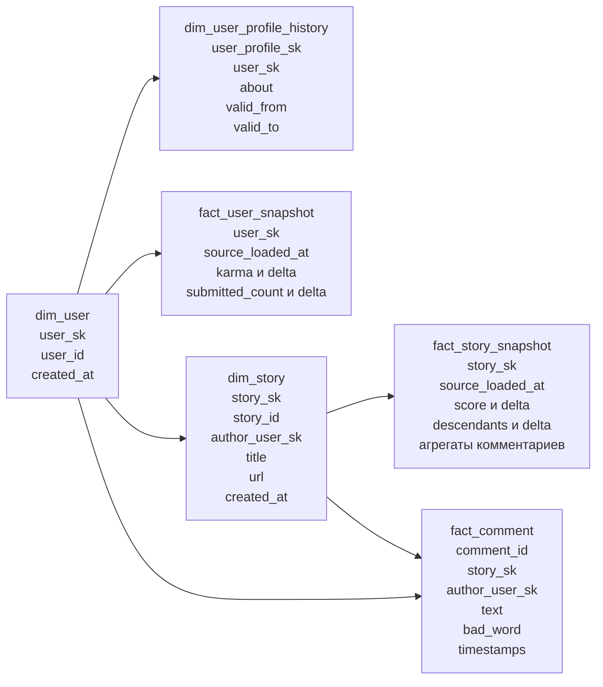

# Лабораторная работа №2: DDS и Data Quality — дизайн

> **Superseded:** схема с отдельным Airflow ЛР2 заменена единым корневым Compose. Актуальная спецификация: `docs/superpowers/specs/2026-09-25-shared-compose-design.md`.

Дата согласования: 2026-09-24

## 1. Цель

Построить поверх ODS первой лабораторной очищенный и нормализованный DDS-слой в PostgreSQL, который позволяет:

- анализировать изменение `score` и числа комментариев публикаций;
- анализировать изменение `karma` и активности авторов;
- сохранять комментарии первого уровня без дублей;
- отслеживать изменение описания профиля пользователя через SCD Type 2;
- автоматически проверять качество данных после каждой успешной загрузки.

Успешный результат:

- повторный запуск не создаёт дубликаты;
- новые и обновлённые ODS-строки попадают в DDS;
- снимки публикаций и пользователей сохраняют историю;
- SCD2-интервалы профилей не пересекаются;
- DQ DAG даёт явный pass/fail и сохраняет результаты проверок;
- модель и код можно продемонстрировать через Airflow UI и PostgreSQL.

## 2. Границы работы

В рамках ЛР-2:

- источник — top stories Hacker News;
- комментарии — только первый уровень;
- ODS-таблицы — `public.stories`, `public.users`, `public.comments`;
- DDS создаётся в схеме `dds` той же PostgreSQL;
- аналитический порог `karma >= 300` применяется в запросах, а не при ODS-загрузке;
- отдельные таблицы для анализа слов в заголовках не создаются;
- содержимое статей по внешним URL не загружается;
- витрины, Superset и OpenMetadata остаются объёмом ЛР-3.

## 3. Изменение ЛР-1

В `lab_1/dags/user_etl.py` удаляется существующий фильтр `karma >= 500`. ODS должна сохранять всех найденных авторов top stories, иначе история роста до выбранного аналитического порога будет потеряна.

Другие DAG и таблицы ЛР-1 не изменяются.

## 4. Развёртывание

`lab_2` получает собственный Airflow-стек и собственную metadata database. Контейнеры ЛР-2 подключаются к внешней Docker-сети `lab_1_default` и используют существующий сервис `postgres-ods:5432` первой лабораторной.

Следствие: Airflow ЛР-2 автономен, но PostgreSQL из `lab_1` должна быть запущена. Общий каталог данных PostgreSQL между двумя контейнерами не монтируется.

Параметры основного DAG:

- расписание: `0 */8 * * *` — 00:00, 08:00 и 16:00 по `Europe/Moscow`;
- `catchup=False`;
- `max_active_runs=1`.

## 5. Модель DDS

Выбрана нормализованная снежинка с несколькими таблицами фактов.



### 5.1. `dds.dim_user`

Одна строка на пользователя Hacker News.

| Поле | Тип | Ограничение / смысл |
|---|---|---|
| `user_sk` | `BIGSERIAL` | PK, технический ключ |
| `user_id` | `TEXT` | NOT NULL, UNIQUE, username из Hacker News |
| `created_at` | `TIMESTAMPTZ` | Может быть NULL для автора, найденного только в комментарии |
| `dds_loaded_at` | `TIMESTAMPTZ` | NOT NULL |

Пользователи собираются из `public.users.id`, `public.stories.author` и `public.comments.author`.

### 5.2. `dds.dim_user_profile_history`

SCD Type 2 для изменяемого поля `about`.

| Поле | Тип | Ограничение / смысл |
|---|---|---|
| `user_profile_sk` | `BIGSERIAL` | PK |
| `user_sk` | `BIGINT` | NOT NULL, FK на `dim_user` |
| `about` | `TEXT` | Очищенное описание профиля |
| `valid_from` | `TIMESTAMPTZ` | NOT NULL |
| `valid_to` | `TIMESTAMPTZ` | NULL для текущей версии |

Ограничения:

- `UNIQUE(user_sk, valid_from)`;
- частичный уникальный индекс обеспечивает не более одной строки с `valid_to IS NULL` на пользователя;
- новая версия создаётся только при фактическом изменении очищенного `about`.

### 5.3. `dds.fact_user_snapshot`

Зерно: один пользователь после одной ODS-загрузки.

| Поле | Тип | Ограничение / смысл |
|---|---|---|
| `user_sk` | `BIGINT` | PK/FK на `dim_user` |
| `source_loaded_at` | `TIMESTAMPTZ` | PK, время ODS-загрузки |
| `karma` | `INTEGER` | NOT NULL |
| `karma_delta` | `INTEGER` | NULL для первого снимка |
| `submitted_count` | `INTEGER` | NOT NULL, не меньше нуля |
| `submitted_count_delta` | `INTEGER` | NULL для первого снимка |
| `dds_loaded_at` | `TIMESTAMPTZ` | NOT NULL |

PK: `(user_sk, source_loaded_at)`.

### 5.4. `dds.dim_story`

Одна строка на публикацию Hacker News.

| Поле | Тип | Ограничение / смысл |
|---|---|---|
| `story_sk` | `BIGSERIAL` | PK |
| `story_id` | `BIGINT` | NOT NULL, UNIQUE, ID Hacker News |
| `author_user_sk` | `BIGINT` | FK на `dim_user`, может быть NULL для удалённого автора |
| `title` | `TEXT` | NOT NULL, очищенный заголовок |
| `url` | `TEXT` | Может быть NULL |
| `created_at` | `TIMESTAMPTZ` | NOT NULL |
| `dds_loaded_at` | `TIMESTAMPTZ` | NOT NULL |

### 5.5. `dds.fact_story_snapshot`

Зерно: одна публикация после одной ODS-загрузки.

| Поле | Тип | Ограничение / смысл |
|---|---|---|
| `story_sk` | `BIGINT` | PK/FK на `dim_story` |
| `source_loaded_at` | `TIMESTAMPTZ` | PK, время ODS-загрузки |
| `score` | `INTEGER` | NOT NULL, не меньше нуля |
| `score_delta` | `INTEGER` | NULL для первого снимка |
| `descendants` | `INTEGER` | NOT NULL, не меньше нуля |
| `descendants_delta` | `INTEGER` | NULL для первого снимка |
| `loaded_comments_count` | `INTEGER` | Число загруженных комментариев первого уровня |
| `bad_word_comments_count` | `INTEGER` | Число загруженных комментариев с `bad_word=true` |
| `dds_loaded_at` | `TIMESTAMPTZ` | NOT NULL |

PK: `(story_sk, source_loaded_at)`.

`descendants` приходит из Hacker News и описывает всё дерево комментариев. `loaded_comments_count` относится только к фактически загруженным комментариям первого уровня.

### 5.6. `dds.fact_comment`

Зерно: один уникальный комментарий первого уровня.

| Поле | Тип | Ограничение / смысл |
|---|---|---|
| `comment_id` | `BIGINT` | PK, ID Hacker News |
| `story_sk` | `BIGINT` | NOT NULL, FK на `dim_story` |
| `author_user_sk` | `BIGINT` | FK на `dim_user`, может быть NULL |
| `text` | `TEXT` | Очищенный текст без HTML |
| `bad_word` | `BOOLEAN` | NOT NULL, результат обогащения ЛР-1 |
| `created_at` | `TIMESTAMPTZ` | NOT NULL |
| `source_loaded_at` | `TIMESTAMPTZ` | NOT NULL |
| `dds_loaded_at` | `TIMESTAMPTZ` | NOT NULL |

Неоднозначное ODS-поле `comments.parent` преобразуется в явную связь `story_sk`, потому что собираются только прямые комментарии публикации.

## 6. Технические таблицы

### 6.1. `dds.pipeline_state`

Хранит последний успешно обработанный watermark каждого ODS-источника.

| Поле | Тип | Ограничение / смысл |
|---|---|---|
| `source_name` | `TEXT` | PK: `stories`, `users`, `comments` |
| `last_processed_at` | `TIMESTAMPTZ` | Последняя успешная верхняя граница |
| `updated_at` | `TIMESTAMPTZ` | Время обновления состояния |

### 6.2. `dds.data_quality_results`

Не входит в снежинку; это журнал проверок.

| Поле | Тип | Ограничение / смысл |
|---|---|---|
| `run_id` | `TEXT` | Идентификатор DQ-запуска |
| `check_name` | `TEXT` | Название проверки |
| `status` | `BOOLEAN` | Pass/fail |
| `actual_value` | `TEXT` | Наблюдаемое значение |
| `expected_rule` | `TEXT` | Ожидаемое условие |
| `details` | `TEXT` | Детали ошибки |
| `checked_at` | `TIMESTAMPTZ` | Время проверки |

PK: `(run_id, check_name)`.

## 7. Нормализация

Модель соответствует выбранной семантике 3НФ:

- постоянные атрибуты пользователя зависят от `user_sk`;
- версия `about` зависит от пользователя и начала периода действия;
- `karma` и `submitted_count` зависят от пользователя и момента снимка;
- постоянные атрибуты публикации зависят от `story_sk`;
- `score`, `descendants` и агрегаты зависят от публикации и момента снимка;
- поля комментария зависят от `comment_id`;
- данные автора не дублируются в публикациях и комментариях.

`*_delta`, `loaded_comments_count`, `bad_word_comments_count` являются осознанными аналитическими мерами фактов, а не описательными атрибутами измерений.

## 8. Incremental-алгоритм

При запуске `dds_incremental_etl`:

1. Идемпотентно создать схему и технические таблицы DDS, если это первый запуск.
2. Прочитать watermarks из `dds.pipeline_state`.
3. Зафиксировать `MAX(loaded_at)` для `public.stories`, `public.users`, `public.comments`.
4. Если ни один максимум не больше watermark, завершить DAG со статусом success и skipped для загрузочных задач.
5. Для изменившихся источников читать окно `(last_processed_at, captured_max]`.
6. Добавить отсутствующих пользователей из новых/обновлённых users, stories и comments.
7. Обновить SCD2-профили и добавить снимки пользователей.
8. Upsert измерения публикаций.
9. Upsert комментарии первого уровня.
10. Добавить снимки публикаций, рассчитав дельты и агрегаты уже после загрузки комментариев.
11. Только после успешной загрузки обновить watermarks до зафиксированных максимумов.
12. Запустить отдельный `dds_data_quality` DAG.

Зафиксированная верхняя граница не позволяет потерять строки, появившиеся во время работы DAG: они остаются для следующего запуска.

## 9. Очистка, обогащение и агрегация

Очистка:

- дедупликация по естественным ключам;
- `TRIM`, нормализация пробелов, пустые строки → `NULL`;
- удаление HTML и декодирование HTML entities в `about` и `comments.text`;
- явное приведение чисел, boolean и timestamps;
- интерпретация исходных naive timestamps как UTC с хранением в `TIMESTAMPTZ`.

Обогащение:

- `score_delta`, `descendants_delta`;
- `karma_delta`, `submitted_count_delta`;
- преобразование `parent` в явную связь с `dim_story`.

Агрегация:

- `loaded_comments_count`;
- `bad_word_comments_count`.

## 10. Идемпотентность и отказоустойчивость

- Измерения загружаются через `INSERT ... ON CONFLICT ... DO UPDATE`.
- Снимки защищены составными PK `(entity_sk, source_loaded_at)`.
- Комментарии защищены PK `comment_id`.
- Watermark обновляется последним.
- Если загрузка падает до обновления watermark, следующий запуск повторяет то же окно; ограничения не позволяют создать дубликаты.
- Верхние границы источников фиксируются до чтения строк.
- Один активный запуск обеспечивается `max_active_runs=1`.
- Операции одного загрузочного шага выполняются в транзакции PostgreSQL.

## 11. DAG-и

### `dds_incremental_etl`

Логические задачи:

1. `ensure_dds_schema`;
2. `check_ods_changes`;
3. `load_dim_user`;
4. `load_user_profile_history`;
5. `load_fact_user_snapshot`;
6. `load_dim_story`;
7. `load_fact_comment`;
8. `load_fact_story_snapshot`;
9. `update_pipeline_state`;
10. `trigger_data_quality`.

Между задачами передаются только watermarks, cutoffs и небольшие счётчики. Наборы строк через XCom не передаются.

### `dds_data_quality`

Группы проверок:

- completeness;
- uniqueness;
- referential integrity;
- validity;
- SCD2 consistency;
- ODS/DDS reconciliation;
- snapshot history and idempotency.

Каждая проверка сохраняет результат в `dds.data_quality_results`. Обязательная проверка с `status=false` завершает соответствующую задачу через `AirflowException`, поэтому DQ DAG становится failed.

## 12. Проверки качества

Минимальный набор:

- обязательные ключи и меры не NULL;
- уникальны `user_id`, `story_id`, `comment_id` и составные ключи снимков;
- отсутствуют orphan FK;
- `score`, `descendants`, `submitted_count` и агрегаты неотрицательны;
- timestamps не находятся в будущем;
- не более одной открытой SCD2-версии пользователя;
- SCD2-интервалы не пересекаются;
- каждому ODS-снимку обработанного окна соответствует DDS-снимок;
- каждый ODS-комментарий до watermark присутствует в `fact_comment`;
- агрегаты удовлетворяют `bad_word_comments_count <= loaded_comments_count <= descendants`, когда источник согласован.

Последнее условие должно учитывать, что `descendants` и выгрузка комментариев получены неатомарно из внешнего API. При подтверждённой гонке источника расхождение фиксируется как предупреждение, а не как блокирующая ошибка.

## 13. Верификация реализации

Статические проверки:

- импорт DAG без ошибок;
- проверка структуры и зависимостей DAG;
- форматирование и lint Python/SQL.

Интеграционные проверки:

- создание схемы с чистого состояния;
- первая полная загрузка;
- повторный запуск без новых ODS-данных ничего не изменяет;
- новая ODS-загрузка создаёт новые снимки;
- повторная обработка одного окна не создаёт дубли;
- изменение `about` закрывает старую и открывает новую SCD2-версию;
- искусственно созданный дубль/orphan/аномалия приводит к failed DQ DAG;
- исправленные данные возвращают DQ DAG в success.

## 14. Артефакты ЛР-2

Планируемая структура:

```text
lab_2/
├── docker-compose.yaml
├── .env.example
├── dags/
│   ├── dds_incremental_etl.py
│   └── dds_data_quality.py
├── sql/
│   ├── create_dds_schema.sql
│   ├── load_dds.sql
│   └── data_quality_checks.sql
├── tests/
├── docs/
│   └── superpowers/
│       ├── specs/
│       └── plans/
└── README.md
```

README должен содержать схему, объяснение 3НФ/SCD2, алгоритм инкрементальной загрузки, DQ-проверки, команды запуска и сценарий демонстрации на защите.
