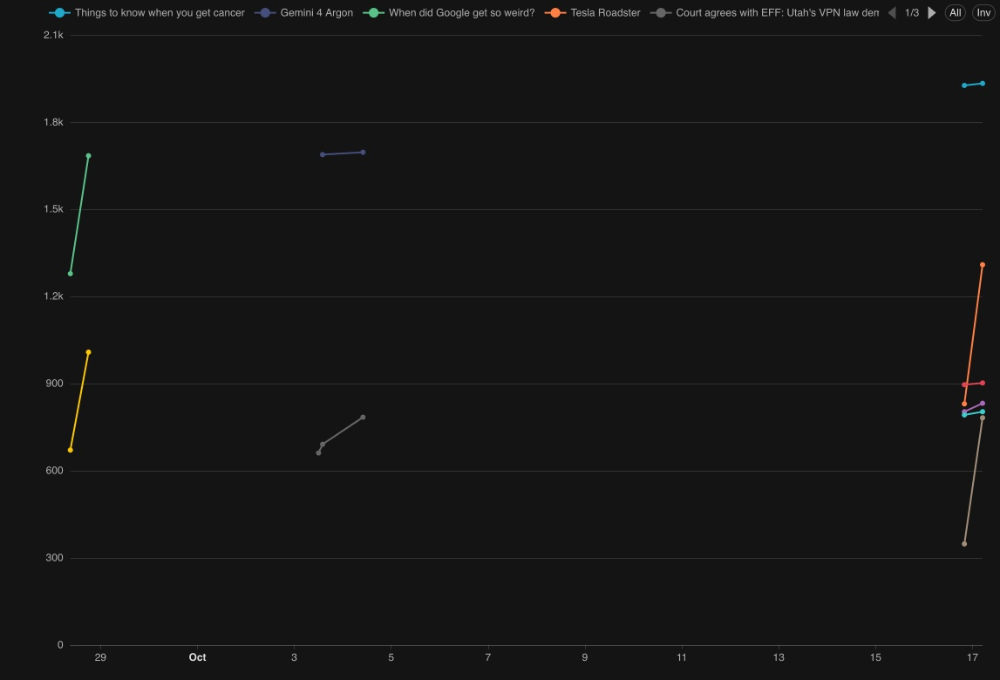
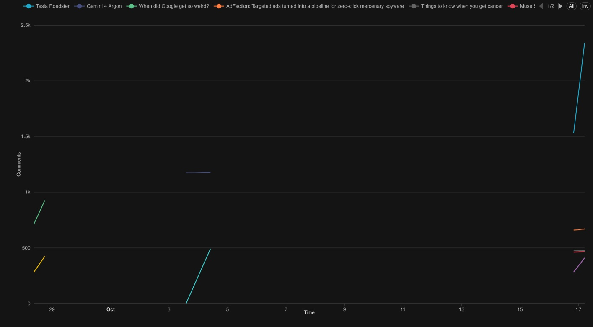
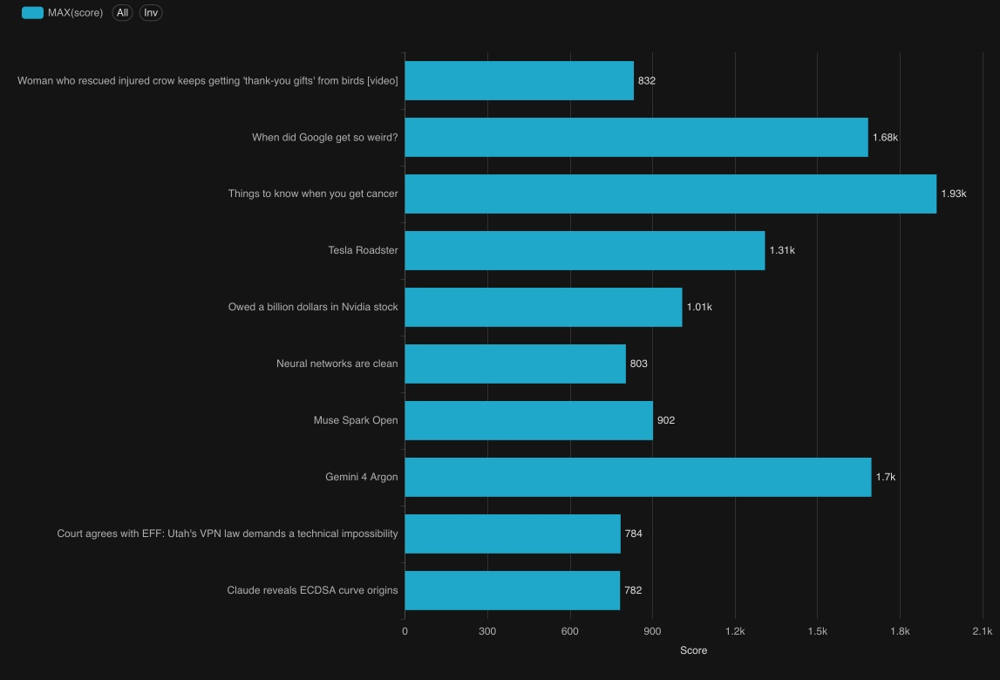
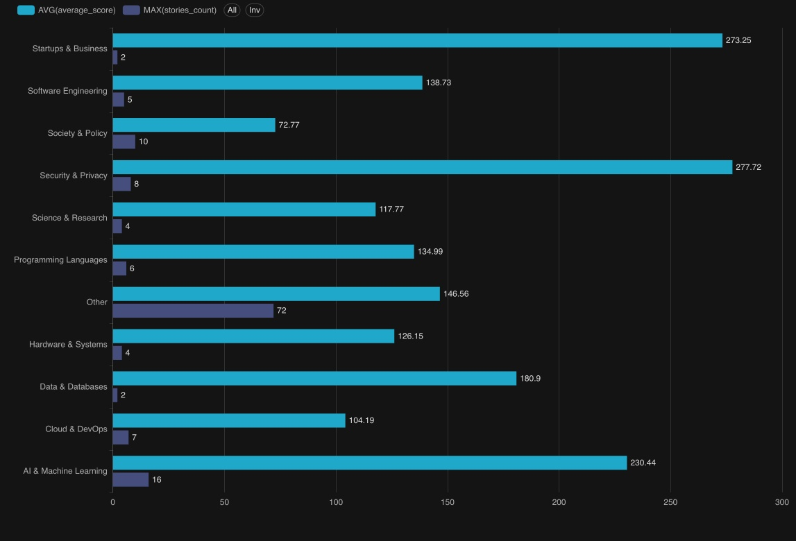
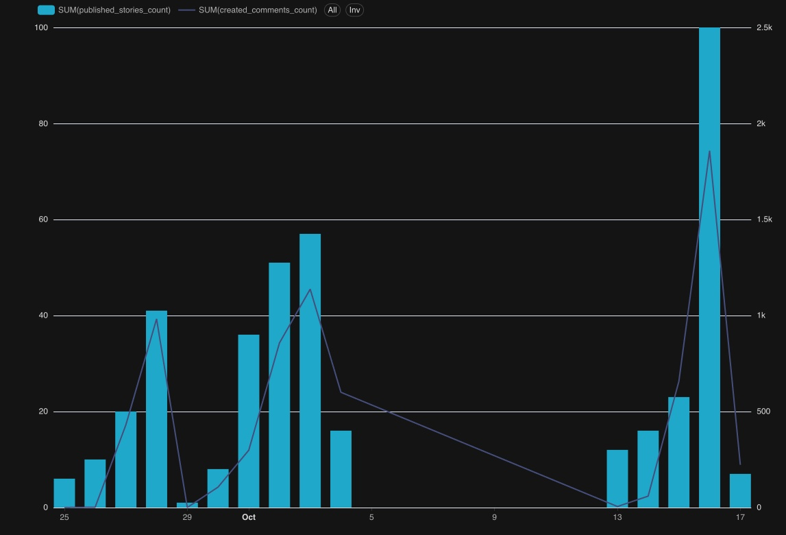

# Отчёт по лабораторной работе №3

## Построение витрин данных, визуализация в Superset и Data Lineage в OpenMetadata

## 1. Цель работы

Цель лабораторной работы — построить аналитические витрины на основе
детального слоя DDS, организовать их автоматическое обновление в Apache
Airflow, создать дашборд в Apache Superset и отразить полный путь данных в
OpenMetadata.

В ходе работы необходимо:

1. добавить Superset и OpenMetadata в общую конфигурацию Docker Compose;
2. спроектировать витрины, каждая из которых отвечает на определённый
   аналитический вопрос;
3. реализовать SQL- и Python-процессы формирования витрин из DDS;
4. связать ETL витрин с процессами второй лабораторной работы;
5. проверить качество рассчитанных данных до их публикации;
6. построить не менее пяти визуализаций и объяснить выбор каждого графика;
7. настроить Data Lineage от Hacker News API до дашборда;
8. подготовить воспроизводимые команды запуска и проверки результата.

Лабораторная работа продолжает единый конвейер проекта:

```text
Hacker News API
      ↓
ЛР1: ODS, схема public
      ↓
ЛР2: DDS, схема dds
      ↓
ЛР3: витрины, схема marts
      ├──→ Superset
      └──→ OpenMetadata
```

## 2. Постановка аналитической задачи

Исходные данные Hacker News содержат публикации, пользователей, комментарии
и последовательные снимки изменяющихся показателей. Детальный DDS хорошо
подходит для хранения истории и обеспечения ссылочной целостности, но для
визуализации требует повторяющихся соединений и оконных вычислений.

В ЛР3 поверх DDS создаются специализированные витрины. Они должны позволять
ответить на следующие вопросы:

- как изменяется рейтинг конкретной публикации во времени;
- как развивается обсуждение публикации;
- какие публикации лидируют по текущему рейтингу;
- как изменяется карма авторов;
- какие тематики получают больший рейтинг и охват;
- в какие дни пользователи публикуют больше историй и комментариев.

Витрина отличается от DDS тем, что проектируется под конкретный сценарий
чтения. Поэтому данные в ней намеренно денормализованы и уже содержат
вычисленные показатели. Superset выполняет простые фильтрации и агрегации,
а не повторяет сложные преобразования при каждом открытии дашборда.

## 3. Общая архитектура

ODS, DDS и витрины находятся в одной прикладной базе `ods` сервиса
`postgres-ods`, но разделены схемами:

- `public` — ODS первой лабораторной работы;
- `dds` — нормализованный детальный слой второй лабораторной работы;
- `marts_staging` — временная область расчёта и проверки витрин;
- `marts` — опубликованные витрины, доступные Superset и OpenMetadata.

Служебные данные Airflow, Superset и OpenMetadata размещаются отдельно и не
смешиваются с аналитическими таблицами.

```text
                        ┌──────────────────────────┐
Hacker News API ───────►│ PostgreSQL postgres-ods │
                        │                          │
                        │ public: ODS              │
                        │      ↓                   │
                        │ dds: detailed data       │
                        │      ↓                   │
                        │ marts_staging            │
                        │      ↓ Data Quality      │
                        │ marts: published data    │
                        └────────────┬─────────────┘
                                     │
                         ┌───────────┴───────────┐
                         ▼                       ▼
                    Superset               OpenMetadata
                  визуализация        каталог и Data Lineage
```


## 5. Исходный детальный слой DDS

Формирование витрин использует результаты второй лабораторной работы.

| Таблица DDS | Использование в ЛР3 |
|---|---|
| `dds.dim_user` | Бизнес-идентификатор пользователя и дата регистрации |
| `dds.fact_user_snapshot` | История кармы и количества отправленных объектов |
| `dds.dim_story` | Заголовок, URL, автор и время создания публикации |
| `dds.fact_story_snapshot` | История рейтинга и количества комментариев |
| `dds.fact_comment` | Фактические комментарии и дневная активность |


В DDS изменяющиеся показатели представлены последовательными снимками:

```text
(story_sk, source_loaded_at) -> score, descendants, deltas
(user_sk, source_loaded_at)  -> karma, submitted_count, deltas
```


## 6. Проектирование витрин

В ЛР3 создано пять физических витрин.

| Витрина | Гранулярность | Аналитический вопрос |
|---|---|---|
| `marts.story_dynamics` | Публикация и момент снимка | Как меняются рейтинг и обсуждение публикации? |
| `marts.current_story_ranking` | Одна актуальная строка на публикацию | Какие публикации сейчас лидируют? |
| `marts.author_dynamics` | Автор и момент снимка | Как меняются карма и активность автора? |
| `marts.topic_performance` | Дата и тематика | Какие тематики популярнее и результативнее? |
| `marts.daily_activity` | Календарная дата | В какие дни активность пользователей максимальна? |

В отличие от нормализованной модели DDS, витрины денормализованы. Например,
`story_dynamics` одновременно содержит название публикации, автора,
тематику и показатели снимка. Такое дублирование допустимо, потому что слой
`marts` оптимизирован для аналитического чтения.

### 6.1. Витрина `marts.story_dynamics`

Гранулярность: одно состояние одной публикации в один момент загрузки.
Первичный ключ — `(story_id, snapshot_at)`.

| Столбец | Тип | Назначение |
|---|---|---|
| `story_id` | `BIGINT` | Естественный ID публикации Hacker News |
| `title` | `TEXT` | Заголовок публикации |
| `url` | `TEXT` | Ссылка на внешний материал |
| `source_domain` | `TEXT` | Домен, вычисленный из URL |
| `topic` | `TEXT` | Тема, присвоенная классификатором |
| `author_id` | `TEXT` | Имя автора публикации |
| `story_created_at` | `TIMESTAMPTZ` | Время создания публикации |
| `snapshot_at` | `TIMESTAMPTZ` | Время снимка показателей |
| `age_hours` | `NUMERIC` | Возраст публикации в часах на момент снимка |
| `score` | `INTEGER` | Рейтинг в момент снимка |
| `score_delta` | `INTEGER` | Изменение рейтинга с предыдущего снимка |
| `descendants` | `INTEGER` | Общее число потомков-комментариев |
| `descendants_delta` | `INTEGER` | Изменение числа потомков |
| `loaded_comments_count` | `INTEGER` | Число реально загруженных комментариев первого уровня |

Витрина используется для двух временных графиков: динамики рейтинга и
динамики обсуждения.

### 6.2. Витрина `marts.current_story_ranking`

Гранулярность: одно последнее известное состояние одной публикации.
Первичный ключ — `story_id`.

| Столбец | Тип | Назначение |
|---|---|---|
| `story_id` | `BIGINT` | ID публикации |
| `title` | `TEXT` | Заголовок публикации |
| `url` | `TEXT` | Внешняя ссылка |
| `source_domain` | `TEXT` | Домен источника |
| `topic` | `TEXT` | Классифицированная тематика |
| `author_id` | `TEXT` | Автор публикации |
| `story_created_at` | `TIMESTAMPTZ` | Время публикации |
| `last_snapshot_at` | `TIMESTAMPTZ` | Время выбранного последнего снимка |
| `age_hours` | `NUMERIC` | Возраст публикации на момент последнего снимка |
| `score` | `INTEGER` | Текущий известный рейтинг |
| `score_delta` | `INTEGER` | Последнее изменение рейтинга |
| `descendants` | `INTEGER` | Текущее известное число потомков |
| `descendants_delta` | `INTEGER` | Последнее изменение числа потомков |
| `loaded_comments_count` | `INTEGER` | Загруженные комментарии первого уровня |
| `score_rank` | `BIGINT` | Место в рейтинге по убыванию `score` |

Последний снимок определяется через `ROW_NUMBER() OVER (PARTITION BY
story_id ORDER BY snapshot_at DESC)`. После этого место вычисляется функцией
`RANK()`.

### 6.3. Витрина `marts.author_dynamics`

Гранулярность: состояние одного пользователя в один момент загрузки.
Первичный ключ — `(user_id, snapshot_at)`.

| Столбец | Тип | Назначение |
|---|---|---|
| `user_id` | `TEXT` | Имя пользователя Hacker News |
| `user_created_at` | `TIMESTAMPTZ` | Время регистрации пользователя |
| `snapshot_at` | `TIMESTAMPTZ` | Время снимка профиля |
| `karma` | `INTEGER` | Карма пользователя в момент снимка |
| `karma_delta` | `INTEGER` | Изменение кармы с предыдущего снимка |
| `submitted_count` | `INTEGER` | Количество отправленных объектов |
| `submitted_count_delta` | `INTEGER` | Изменение количества отправленных объектов |

Карма Hacker News может быть отрицательной у оштрафованных пользователей,
поэтому на `karma` нет ограничения `CHECK (karma >= 0)`. Фильтр
`karma >= 300` применяется только в соответствующей визуализации Superset и
не удаляет пользователей из витрины.

### 6.4. Витрина `marts.topic_performance`

Гранулярность: одна тематика за одну календарную дату UTC. Первичный ключ —
`(snapshot_date, topic)`.

| Столбец | Тип | Назначение |
|---|---|---|
| `snapshot_date` | `DATE` | Дата снимка в UTC |
| `topic` | `TEXT` | Тематика публикаций |
| `stories_count` | `BIGINT` | Количество публикаций темы |
| `authors_count` | `BIGINT` | Количество уникальных авторов темы |
| `average_score` | `NUMERIC` | Средний рейтинг публикаций темы |
| `maximum_score` | `INTEGER` | Максимальный рейтинг в теме |
| `average_comments` | `NUMERIC` | Среднее количество потомков-комментариев |
| `total_score_growth` | `BIGINT` | Суммарное изменение рейтинга за день |
| `total_comments_growth` | `BIGINT` | Суммарное изменение числа комментариев за день |

Для показателей состояния выбирается последний снимок каждой публикации за
день. Дельты суммируются по всем снимкам дня, поэтому показатели роста не
теряются.

### 6.5. Витрина `marts.daily_activity`

Гранулярность: один календарный день UTC. Первичный ключ — `activity_date`.

| Столбец | Тип | Назначение |
|---|---|---|
| `activity_date` | `DATE` | Дата события в UTC |
| `published_stories_count` | `BIGINT` | Число созданных публикаций |
| `created_comments_count` | `BIGINT` | Число созданных комментариев первого уровня |
| `story_authors_count` | `BIGINT` | Уникальные авторы публикаций |
| `comment_authors_count` | `BIGINT` | Уникальные авторы комментариев |
| `active_users_count` | `BIGINT` | Уникальные пользователи с любой активностью |

`active_users_count` не является суммой двух предыдущих показателей. Автор,
который в один день опубликовал историю и оставил комментарий, учитывается
один раз благодаря `UNION` по пользователю и дате.

## 7. Промежуточная схема `marts_staging`

В `marts_staging` находятся копии пяти конечных витрин и таблица
`story_topics`:

```text
marts_staging.story_topics
marts_staging.story_dynamics
marts_staging.current_story_ranking
marts_staging.author_dynamics
marts_staging.topic_performance
marts_staging.daily_activity
```

`story_topics` имеет гранулярность «одна публикация — одна тема» и содержит:

| Столбец | Назначение |
|---|---|
| `story_id` | ID публикации и первичный ключ |
| `topic` | Непустая строка с категорией |

Схема `marts_staging` решает две задачи:

1. позволяет полностью рассчитать новый набор витрин, не изменяя данные,
   которые в этот момент читает Superset;
2. предоставляет отдельную область для блокирующих проверок качества.

OpenMetadata получает только схемы `public`, `dds` и `marts`.
`marts_staging` является технической схемой и исключается из metadata
ingestion.

## 8. Классификация тематик

Тематика отсутствует в Hacker News API, поэтому она вычисляется в ЛР3.
Реализация находится в
[`dags/lab3_lib/topic_classifier.py`](dags/lab3_lib/topic_classifier.py).

### 8.1. Используемый подход

Применяется zero-shot классификация по близости эмбеддингов:

1. для каждой тематической категории задано английское предметное описание;
2. модель превращает описания категорий в векторы;
3. заголовок публикации, домен и путь URL превращаются в вектор той же
   размерности;
4. вычисляется cosine similarity между публикацией и всеми категориями;
5. выбирается категория с наибольшей близостью;
6. если лучшая близость меньше `0.7`, возвращается `Other`.

Для публикаций и описаний применяется префикс:

```text
task: clustering | query:
```

Содержимое внешней веб-страницы не загружается. Это делает классификацию
воспроизводимой и не добавляет сетевые запросы к произвольным сайтам.


### 8.2. Категории

Классификатор различает десять основных категорий:

1. `AI & Machine Learning`;
2. `Software Engineering`;
3. `Programming Languages`;
4. `Data & Databases`;
5. `Cloud & DevOps`;
6. `Security & Privacy`;
7. `Hardware & Systems`;
8. `Science & Research`;
9. `Startups & Business`;
10. `Society & Policy`.

`Other` не кодируется как отдельная категория. Она используется только как
результат при недостаточной cosine similarity.

## 9. Формирование витрин

SQL-преобразования находятся в трёх файлах:

- [`sql/create_marts_schema.sql`](sql/create_marts_schema.sql) — схемы,
  таблицы, ограничения и индексы;
- [`sql/build_staging_marts.sql`](sql/build_staging_marts.sql) — полная
  пересборка промежуточных витрин;
- [`sql/publish_marts.sql`](sql/publish_marts.sql) — публикация проверенных
  данных.

### 9.1. `story_dynamics`

Выполняются соединения:

```text
dds.dim_story
  JOIN dds.fact_story_snapshot
  JOIN marts_staging.story_topics
  LEFT JOIN dds.dim_user
```

Из URL извлекается домен. Возраст публикации вычисляется как разность между
временем снимка и временем создания в часах. `GREATEST(..., 0)` защищает
витрину от отрицательного возраста при погрешности временных меток.

### 9.2. `current_story_ranking`

Из `story_dynamics` выбирается последний снимок каждой публикации, после чего
строки ранжируются по `score DESC, story_id`. Дополнительная сортировка по ID
делает результат детерминированным при одинаковом рейтинге.

### 9.3. `author_dynamics`

`dds.fact_user_snapshot` соединяется с `dds.dim_user`, чтобы заменить
внутренний `user_sk` понятным бизнес-идентификатором `user_id`.

### 9.4. `topic_performance`

Преобразование выполняется в два этапа:

- `daily_state` выбирает последний снимок публикации за день и вычисляет
  количество публикаций, авторов, средний и максимальный рейтинг;
- `daily_growth` суммирует `score_delta` и `descendants_delta` за тот же день.

Два результата соединяются по дате и тематике.

### 9.5. `daily_activity`

Список дат строится как объединение дат публикаций и комментариев. Затем
отдельно рассчитываются показатели публикаций, комментариев и уникальных
активных пользователей. `LEFT JOIN` и `COALESCE(..., 0)` сохраняют дни, в
которые присутствовал только один тип активности.

## 10. DAG `marts_etl`

DAG определён в [`dags/marts_etl.py`](dags/marts_etl.py).

Основные параметры:

| Параметр | Значение | Причина |
|---|---|---|
| `dag_id` | `marts_etl` | Уникальное имя процесса ЛР3 |
| `schedule` | `None` | DAG запускается после успешного DDS либо вручную |
| `catchup` | `False` | Исторические интервалы Airflow не создаются автоматически |
| `max_active_runs` | `1` | Исключается одновременная пересборка одних таблиц |
| `is_paused_upon_creation` | `False` | DAG доступен сразу после загрузки |

Последовательность задач:

```text
ensure_marts_schema
        ↓
classify_story_topics
        ↓
build_staging_marts
        ↓
validate_staging_marts
        ↓
publish_marts
```

| Задача | Назначение |
|---|---|
| `ensure_marts_schema` | Идемпотентно создаёт схемы, таблицы, ограничения и индексы |
| `classify_story_topics` | Пересчитывает тему каждой публикации DDS |
| `build_staging_marts` | Полностью пересобирает пять таблиц `marts_staging` |
| `validate_staging_marts` | Выполняет десять блокирующих DQ-проверок |
| `publish_marts` | Заменяет содержимое пяти конечных витрин одной транзакцией |

Python-функции работы с витринами вынесены в
[`dags/lab3_lib/marts.py`](dags/lab3_lib/marts.py), а проверки качества — в
[`dags/lab3_lib/quality.py`](dags/lab3_lib/quality.py).

## 11. Зависимость от второй лабораторной работы

`marts_etl` не строит витрины по расписанию независимо от DDS. Он запускается
оператором `TriggerDagRunOperator` внутри `dds_incremental_etl`.

```text
ODS изменился
    ↓
dds_incremental_etl
    ↓
dds_data_quality
    ↓ wait_for_completion=True
marts_etl
    ↓ wait_for_completion=True
update_pipeline_state
```

В `dds_incremental_etl` заданы:

```text
trigger_dag_id="marts_etl"
wait_for_completion=True
reset_dag_run=True
```

Это означает, что процесс DDS ждёт завершения ЛР3. Watermark DDS перемещается
только после успешной проверки DDS и успешной публикации витрин. Если ЛР3
завершается ошибкой, состояние источника не продвигается и следующий запуск
может повторно обработать то же окно.

Если новых строк в ODS нет, ветка `no_changes` завершает DDS-процесс без
повторного запуска витрин. Для отдельной проверки `marts_etl` можно запустить
вручную.

## 13. Проверка качества витрин

Data Quality выполняется над `marts_staging` до изменения конечных таблиц.
Реализовано десять блокирующих правил.

| Проверка | Что контролируется |
|---|---|
| `uniqueness.primary_keys` | Уникальность гранулярности всех пяти витрин |
| `completeness.required_values` | Отсутствие `NULL` в обязательных ключах, темах и метриках |
| `validity.non_negative_measures` | Неотрицательные рейтинги, возраста и счётчики |
| `reconciliation.story_dynamics` | Число строк равно числу снимков публикаций DDS |
| `reconciliation.author_dynamics` | Число строк равно числу снимков пользователей DDS |
| `reconciliation.story_topics` | Каждая публикация DDS имеет ровно одну тему |
| `reconciliation.current_story_ranking` | В рейтинге одна строка на публикацию со снимком |
| `consistency.current_story_measures` | Метрики рейтинга совпадают с последним снимком DDS |
| `validity.non_blank_topics` | В тематических витринах нет пустых строк |
| `consistency.score_rank` | Место соответствует сортировке `score DESC, story_id` |

Для каждой проверки формируется `QualityResult`:

```text
name / status / actual_value / expected_rule
```

Все результаты записываются в лог задачи Airflow. Если хотя бы одна проверка
не выполнена, создаётся `DataQualityError`, задача
`validate_staging_marts` падает, а `publish_marts` не запускается.

Отрицательная `karma` не считается ошибкой качества: источник допускает
такое значение. При этом количество отправленных объектов и остальные
счётчики должны оставаться неотрицательными.

## 14. Индексы

В конечной схеме созданы индексы под основные фильтры дашборда:

| Индекс | Назначение |
|---|---|
| `story_dynamics(topic, snapshot_at)` | Фильтрация динамики по теме и периоду |
| `story_dynamics(author_id, snapshot_at)` | Фильтрация по автору и времени |
| `current_story_ranking(score_rank)` | Быстрый выбор top-N публикаций |
| `author_dynamics(user_id, snapshot_at)` | Временной ряд выбранного автора |
| `topic_performance(topic, snapshot_date)` | Анализ тем за период |

Первичные ключи автоматически создают уникальные индексы по гранулярности
каждой витрины.

## 15. Визуализация в Superset

Superset подключается к прикладной базе `ods` по внутреннему имени Docker
сервиса `postgres-ods`. Служебная БД `superset-db` хранит настройки,
datasets, charts и dashboards, но не копирует строки витрин.

В Superset зарегистрированы пять datasets:

```text
marts.story_dynamics
marts.current_story_ranking
marts.author_dynamics
marts.topic_performance
marts.daily_activity
```

Создан дашборд `Hacker News Analytics` с шестью самостоятельными
визуализациями.

### 15.1. Динамика рейтинга публикаций

- dataset: `marts.story_dynamics`;
- тип: `Line Chart`;
- ось времени: `snapshot_at`, шаг один час;
- метрика: `MAX(score)`;
- серия: `title`;
- ограничение: десять серий.

Линейный график выбран, потому что показывает направление и скорость
изменения рейтинга во времени. По нему можно увидеть момент быстрого роста,
стабилизацию и сравнить траектории нескольких публикаций.

### 15.2. Динамика обсуждения публикаций

- dataset: `marts.story_dynamics`;
- тип: `Line Chart`;
- ось времени: `snapshot_at`, шаг один час;
- метрика: `MAX(descendants)`;
- серия: `title`;
- сортировка серий по числу комментариев.

Временной график позволяет определить, какие публикации продолжают получать
комментарии, и сравнить рост обсуждения с ростом рейтинга.

### 15.3. Текущий рейтинг публикаций

- dataset: `marts.current_story_ranking`;
- тип: горизонтальный `Bar Chart`;
- категория: `title`;
- метрика: `MAX(score)`;
- фильтр: `score_rank <= 10`;
- сортировка: по рейтингу по убыванию.

Горизонтальные столбцы удобны для длинных заголовков и наглядно показывают
разницу между top-10 публикациями.

### 15.4. Динамика кармы авторов

- dataset: `marts.author_dynamics`;
- тип: `Line Chart`;
- ось времени: `snapshot_at`;
- метрика: `MAX(karma)`;
- серия: `user_id`;
- фильтр визуализации: `karma >= 300`;
- шкала: логарифмическая.

Временной график показывает изменение репутации пользователя. Логарифмическая
шкала уменьшает визуальный перекос между авторами с кармой в сотни и десятки
тысяч. Фильтр 300 относится только к аналитическому представлению.

### 15.5. Результативность тематик

- dataset: `marts.topic_performance`;
- тип: горизонтальный `Bar Chart`;
- категория: `topic`;
- метрики: `AVG(average_score)` и `MAX(stories_count)`;
- временной фильтр: `snapshot_date`.

Столбчатое сравнение отвечает сразу на два вопроса: сколько публикаций
относится к теме и какой средний рейтинг они получают. Это позволяет
отличить массовую тему от темы с небольшим числом, но высоким качеством
публикаций.

### 15.6. Дневная активность

- dataset: `marts.daily_activity`;
- тип: `Mixed Time-Series`;
- ось времени: `activity_date`, шаг один день;
- столбцы: `SUM(published_stories_count)`;
- линия на второй оси: `SUM(created_comments_count)`.

Смешанный график выбран из-за различного масштаба двух показателей. Столбцы
показывают число новых публикаций, линия — объём комментариев. Вторая ось
предотвращает потерю меньшей метрики и помогает находить пики активности.

### 15.7. Фильтры дашборда

Созданы четыре native filter:

| Фильтр | Поле | Область применения |
|---|---|---|
| `Период` | временные столбцы datasets | Все шесть визуализаций |
| `Тема` | `topic` | Динамика публикаций, рейтинг и темы |
| `Автор` | `user_id` | Динамика кармы |
| `Публикация` | `title` | Два графика динамики и рейтинг |

Фильтр применяется только к совместимым datasets. Например, `daily_activity`
не содержит `topic`, поэтому тематический фильтр не должен ограничивать этот
график.

Проверенный экспорт дашборда находится в
[`superset/assets/hacker_news_analytics.zip`](superset/assets/hacker_news_analytics.zip).

## 16. Data Lineage в OpenMetadata

Data Lineage — это граф происхождения и преобразования данных. Он показывает,
откуда появились данные, через какие таблицы и ETL-процессы прошли и какие
аналитические объекты их используют.

В OpenMetadata настроены три основных сервиса:

| Service | Тип | Что импортируется |
|---|---|---|
| `tsd_postgres` | PostgreSQL | Схемы `public`, `dds`, `marts`, таблицы и столбцы |
| `tsd_airflow` | Airflow | DAG, задачи и pipeline metadata |
| `tsd_superset` | Superset | Datasets, charts и dashboard |

Дополнительно вручную создан REST API service `hacker_news_api`, collection
`v0` и endpoint `hacker_news_api.v0.source` с отображаемым именем
`Hacker News API`.

### 16.1. Полная цепочка

Концептуальный путь данных:

```text
Hacker News API
    ↓
public.stories / public.users / public.comments
    ↓
dds.dim_* / dds.fact_*
    ↓
marts.story_dynamics / current_story_ranking /
author_dynamics / topic_performance / daily_activity
    ↓
Superset datasets
    ↓
charts
    ↓
Hacker News Analytics
```

Один конкретный проверочный маршрут с FQN:

```text
hacker_news_api.v0.source
  -> tsd_postgres.ods.public.stories
  -> tsd_postgres.ods.dds.dim_story
  -> tsd_postgres.ods.marts.story_dynamics
  -> tsd_superset.model.1
  -> tsd_superset.1
```

### 16.2. Автоматические и ручные связи

Database ingestion автоматически получает схемы, таблицы, столбцы и типы.
Airflow ingestion импортирует DAG и задачи, Superset ingestion — datasets,
charts и dashboard.

В используемой связке OpenMetadata 1.12.6 и Airflow 3.3.1 упрощённые
`inlets/outlets` импортируются не во всех случаях как table-level edges.
Поэтому недостающие связи ODS → DDS → marts были добавлены через UI как
`PipelineLineage` и привязаны к реальным DAG. Это не вымышленная зависимость:
ручная связь повторяет фактические чтения и записи SQL-процессов.

Связи Hacker News API → ODS также создаются вручную, поскольку внешний API
не является таблицей PostgreSQL и не обнаруживается database ingestion.

### 16.3. Назначение Lineage

Граф позволяет:

- определить источник конкретной метрики дашборда;
- увидеть upstream-таблицы витрины;
- найти downstream-визуализации при изменении столбца;
- оценить влияние изменения через Impact Analysis;
- обнаружить разрыв ingestion или несовпадение FQN.

Пошаговая настройка приведена в
[`openmetadata/README.md`](openmetadata/README.md).

## 17. Структура исходного кода

```text
lab_3/
├── README.md
├── THEORY.md
├── airflow/
│   ├── Dockerfile
│   └── requirements-classifier.txt
├── dags/
│   ├── marts_etl.py
│   └── lab3_lib/
│       ├── marts.py
│       ├── quality.py
│       └── topic_classifier.py
├── sql/
│   ├── create_marts_schema.sql
│   ├── build_staging_marts.sql
│   └── publish_marts.sql
├── superset/
│   ├── Dockerfile
│   ├── init.sh
│   ├── superset_config.py
│   └── assets/
│       ├── README.md
│       └── hacker_news_analytics.zip
├── openmetadata/
│   └── README.md
└── tests/
    ├── test_compose_contract.py
    ├── test_dag_structure.py
    ├── test_lineage_contract.py
    ├── test_marts.py
    ├── test_quality.py
    ├── test_schema.py
    └── test_topic_classifier.py
```

Основные исходные файлы:

| Файл | Назначение |
|---|---|
| [`dags/marts_etl.py`](dags/marts_etl.py) | Определение Airflow DAG и порядка задач |
| [`dags/lab3_lib/marts.py`](dags/lab3_lib/marts.py) | Классификация, выполнение SQL и подсчёт строк |
| [`dags/lab3_lib/quality.py`](dags/lab3_lib/quality.py) | Блокирующие проверки staging-витрин |
| [`dags/lab3_lib/topic_classifier.py`](dags/lab3_lib/topic_classifier.py) | ONNX-классификатор тематик |
| [`sql/create_marts_schema.sql`](sql/create_marts_schema.sql) | DDL схем `marts` и `marts_staging` |
| [`sql/build_staging_marts.sql`](sql/build_staging_marts.sql) | Преобразование DDS в staging-витрины |
| [`sql/publish_marts.sql`](sql/publish_marts.sql) | Атомарная публикация витрин |
| [`superset/assets/hacker_news_analytics.zip`](superset/assets/hacker_news_analytics.zip) | Переносимый экспорт дашборда |
| [`openmetadata/README.md`](openmetadata/README.md) | Ручная настройка ingestion и Lineage |


## 18. Вывод

В лабораторной работе реализован завершающий аналитический слой системы.
Нормализованный DDS преобразуется в пять денормализованных витрин,
ориентированных на конкретные вопросы о рейтинге публикаций, обсуждениях,
авторах, тематиках и пользовательской активности.

Промежуточная схема и блокирующие проверки не позволяют опубликовать
неполный или несогласованный результат. Транзакционная публикация сохраняет
для Superset целостное состояние всех витрин. OpenMetadata дополняет систему
каталогом и Data Lineage, благодаря чему происхождение показателей можно
проследить от внешнего API до конечного графика.

Таким образом, требования лабораторной работы выполнены: сервисы развёрнуты
в едином окружении, витрины автоматизированы, создано более пяти
визуализаций, а реальное движение данных отражено в OpenMetadata.

## 19. Скриншоты визуализаций Superset

Ниже представлены реальные визуализации дашборда
`Hacker News Analytics`, построенные по витринам схемы `marts`.

### 19.1. Динамика рейтинга публикаций

Линейный график показывает изменение `score` выбранных публикаций
между последовательными снимками.



### 19.2. Динамика обсуждения публикаций

График сопоставляет изменение рейтинга публикации и количества
комментариев, что позволяет оценить связь между популярностью и
активностью обсуждения.



### 19.3. Текущий рейтинг публикаций

Столбчатая диаграмма сравнивает актуальные оценки и выделяет наиболее
популярные публикации.



### 19.4. Результативность тематик

Диаграмма сравнивает тематические категории по числу публикаций и их
среднему рейтингу.



### 19.5. Дневная активность

Комбинированная визуализация показывает число публикаций и комментариев
по дням и помогает находить пики активности Hacker News.


